# Marketplace Analytics

**End-to-end e-commerce sales and customer intelligence platform** built on 100k real orders
from the Brazilian marketplace Olist, using Python, MySQL and Power BI.


> Raw CSVs → profiled → cleaned and validated in Python → loaded into a constrained MySQL schema →
> 25 business SQL queries → EDA notebook → RFM segmentation → Power BI star-schema model → business recommendations.
> Every number is reproduced in two tools (SQL and pandas) and checked by automated tests.

---

## Contents
- [Business problem](#business-problem)
- [Key findings](#key-findings)
- [Architecture](#architecture)
- [Tech stack](#tech-stack)
- [Dataset](#dataset)
- [Project workflow](#project-workflow)
- [Database schema](#database-schema)
- [Important SQL queries](#important-sql-queries)
- [Exploratory analysis](#exploratory-analysis)
- [Customer segmentation (RFM)](#customer-segmentation-rfm)
- [Power BI dashboard](#power-bi-dashboard)
- [Business recommendations](#business-recommendations)
- [Installation and how to run](#installation-and-how-to-run)
- [Project structure](#project-structure)
- [Testing and data quality](#testing-and-data-quality)
- [Limitations and future improvements](#limitations-and-future-improvements)

---

## Business problem

A marketplace owner sees orders arrive every day but cannot easily answer:

- Is the business still growing, and what drives revenue: which categories, sellers and regions?
- Do customers come back, and which ones are worth winning back?
- Is delivery reliable, and does it affect customer satisfaction?
- Where should the next investment go?

**Objectives.** Turn raw marketplace data into a reliable analytics platform that answers these
questions with verified metrics, an interactive dashboard and evidence-based recommendations.

## Key findings

All figures come from this project's queries and notebook. Full detail is in
[`reports/business_insights.md`](reports/business_insights.md).

| | Finding |
|---|---|
| 📈 **Growth** | Revenue **R$15.74M**. Jan–Aug 2018 was **+140.4%** vs Jan–Aug 2017, but monthly revenue has been **flat at R$0.98–1.16M** since Jan 2018. |
| 🚚 **Delivery → reviews** | Late or undelivered orders are 9.4% of reviewed orders but cause **42.9% of all 1–2 star reviews**. The average score falls from **4.31** (early) to **1.70** (8+ days late). |
| 🔁 **Retention** | **97.0%** of customers bought only once (repeat rate **3.04%**). Repeat buyers spend **~2×** as much. |
| 🗺️ **Regions** | Southeast = **64.6%** of revenue (São Paulo alone 37.4%). North/Northeast customers pay **~2×** the freight per item. |
| 🏪 **Concentration** | Top **10% of sellers = 67.5%** of revenue; top 10 of 74 categories = 62.4%. |
| 💎 **Segments** | "At Risk" customers (big one-time spenders, inactive 274+ days) are **14.7%** of customers but **27.5%** of revenue. |
| ⚙️ **Logistics** | The late rate peaked at **19.0%** (Mar 2018) after the Black Friday peak (1,166 orders on 24 Nov 2017, ~7.8× a normal day). |

## Architecture

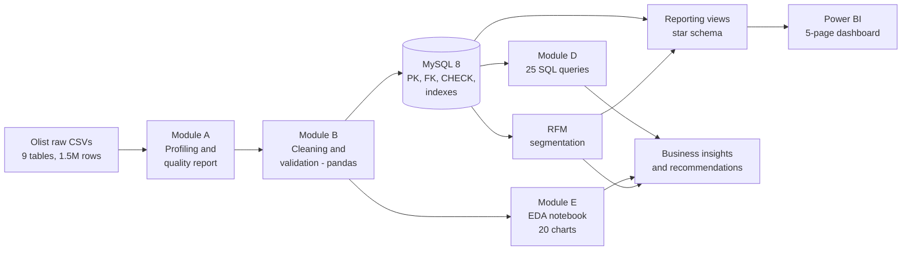

Design principles:
- **Raw data is never modified.** Every step is reproducible from one command.
- **Business rules are decided once** (in the tested Python pipeline) and reused by SQL, pandas and Power BI.
- **Every metric is cross-checked**: SQL vs pandas, MySQL vs CSV, dashboard vs expected values.

## Tech stack

| Layer | Tools |
|---|---|
| Language | Python 3.12, SQL |
| Analysis | pandas, NumPy, Matplotlib, Seaborn, Jupyter |
| Database | MySQL 8.0, SQLAlchemy 2, PyMySQL |
| BI | Power BI Desktop (DAX, star schema) |
| Quality | pytest (115 tests), automated data-quality and validation reports |
| Tooling | VS Code, Git, GitHub, python-dotenv |

## Dataset

**Brazilian E-Commerce Public Dataset by Olist:** about 100k orders placed between 2016 and 2018 on multiple
Brazilian marketplaces, anonymised and released by Olist.

- Source: <https://www.kaggle.com/datasets/olistbr/brazilian-ecommerce>
- License: **CC BY-NC-SA 4.0** (non-commercial use with attribution). The raw data is **not redistributed** in this
  repository; download it from Kaggle (see [Installation](#installation-and-how-to-run)).
- 9 tables: orders, order items, customers, products, sellers, payments, reviews, geolocation, category translation.

## Project workflow

| Module | What it does | Output |
|---|---|---|
| **A. Data understanding** | Profiles every table, verifies primary/foreign keys, runs 30 business-rule checks | [`data_quality_report.md`](reports/data_quality_report.md), [`docs/data_model.md`](docs/data_model.md) |
| **B. Cleaning** | Fixes types, standardises cities, flags invalid deliveries, deduplicates geolocation, validates before saving | [`cleaning_log.md`](reports/cleaning_log.md) |
| **C. Database** | Normalised MySQL schema with 7 foreign keys, 8 CHECK constraints and indexes; loads and verifies the data | [`database_load_report.md`](reports/database_load_report.md), [`docs/database.md`](docs/database.md) |
| **D. SQL analysis** | 25 queries covering the 18 required metrics plus extras | [`sql_analysis_results.md`](reports/sql_analysis_results.md), [`docs/sql_analysis.md`](docs/sql_analysis.md) |
| **E. EDA** | Notebook with 20 charts, each answering a business question | [`01_exploratory_data_analysis.ipynb`](notebooks/01_exploratory_data_analysis.ipynb) |
| **RFM** | Recency/Frequency/Monetary segmentation in Python and SQL (identical results) | [`rfm_segmentation.md`](reports/rfm_segmentation.md), [`docs/rfm.md`](docs/rfm.md) |
| **F. Power BI** | Star-schema views, 41 DAX measures, theme, build guide, expected values | [`powerbi/`](powerbi/), [`powerbi_expected_values.md`](reports/powerbi_expected_values.md) |
| **Insights** | Findings and 10 prioritised recommendations | [`business_insights.md`](reports/business_insights.md) |

## Database schema

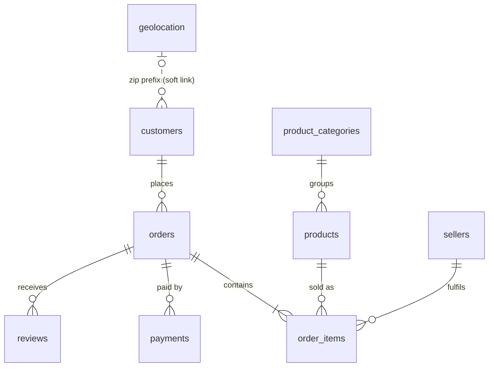

Highlights (full reasoning in [`docs/database.md`](docs/database.md)):
- **`DECIMAL(10,2)` for money**, `CHAR(32)` for Olist IDs, `CHAR(5)` for zip prefixes (keeps leading zeros).
- **CHECK constraints** (`review_score BETWEEN 1 AND 5`, `price > 0`, valid statuses). The loader *proves* they work by attempting bad writes, which MySQL rejects.
- **Customer identity trap handled:** Olist creates a new `customer_id` per order, so all retention metrics use `customer_unique_id`. Using the wrong key would show 0% repeat customers.

## Important SQL queries

All 25 queries are in [`sql/analysis/`](sql/analysis/). Each starts with a comment stating the business question,
and together they use JOINs, GROUP BY/HAVING, CASE, subqueries, CTEs and window functions
(`RANK`, `DENSE_RANK`, `ROW_NUMBER`, `NTILE`, `LAG`, running `SUM`).

<details>
<summary><b>Month-over-month and year-over-year growth</b> (CTE + LAG)</summary>

```sql
WITH monthly AS (
    SELECT o.purchase_year_month AS month, SUM(i.line_total) AS revenue
    FROM orders o JOIN order_items i ON i.order_id = o.order_id
    WHERE o.is_revenue_order = 1 AND o.in_analysis_window = 1
    GROUP BY o.purchase_year_month
)
SELECT month,
       ROUND(revenue, 2) AS revenue,
       ROUND(100 * (revenue - LAG(revenue, 1)  OVER (ORDER BY month))
                 / LAG(revenue, 1)  OVER (ORDER BY month), 2) AS mom_growth_pct,
       ROUND(100 * (revenue - LAG(revenue, 12) OVER (ORDER BY month))
                 / LAG(revenue, 12) OVER (ORDER BY month), 2) AS yoy_growth_pct
FROM monthly ORDER BY month;
```
</details>

<details>
<summary><b>Seller revenue concentration</b> (NTILE deciles + nested window)</summary>

```sql
WITH seller_sales AS (
    SELECT i.seller_id, SUM(i.price) AS product_revenue
    FROM order_items i JOIN orders o ON o.order_id = i.order_id
    WHERE o.is_revenue_order = 1
    GROUP BY i.seller_id
)
SELECT decile,
       COUNT(*) AS sellers,
       ROUND(100 * SUM(product_revenue) / SUM(SUM(product_revenue)) OVER (), 2) AS revenue_share_pct
FROM (SELECT product_revenue, NTILE(10) OVER (ORDER BY product_revenue DESC) AS decile
      FROM seller_sales) d
GROUP BY decile ORDER BY decile;
-- decile 1 (top 10% of sellers) = 67.5% of revenue
```
</details>

<details>
<summary><b>Review score vs delivery delay</b> (CASE buckets)</summary>

```sql
SELECT CASE
         WHEN o.is_valid_delivery = 0               THEN '7. not delivered / no valid date'
         WHEN o.delivery_delay_days <= -7           THEN '1. 7+ days early'
         WHEN o.delivery_delay_days BETWEEN -6 AND -1 THEN '2. 1-6 days early'
         WHEN o.delivery_delay_days = 0             THEN '3. on promised day'
         WHEN o.delivery_delay_days BETWEEN 1 AND 3 THEN '4. 1-3 days late'
         WHEN o.delivery_delay_days BETWEEN 4 AND 7 THEN '5. 4-7 days late'
         ELSE '6. 8+ days late' END                AS delivery_outcome,
       COUNT(*)                                   AS reviews,
       ROUND(AVG(r.review_score), 2)              AS avg_review_score
FROM reviews r JOIN orders o ON o.order_id = r.order_id
WHERE r.is_latest_for_order = 1
GROUP BY delivery_outcome ORDER BY delivery_outcome;
-- 4.31 (7+ days early) ... 1.70 (8+ days late)
```
</details>

<details>
<summary><b>Median without MEDIAN()</b> (ROW_NUMBER + COUNT OVER)</summary>

```sql
WITH valid AS (
    SELECT delivery_days,
           ROW_NUMBER() OVER (ORDER BY delivery_days) AS rn,
           COUNT(*)     OVER ()                       AS n
    FROM orders WHERE is_valid_delivery = 1
)
SELECT AVG(delivery_days) AS median_delivery_days      -- 10.22 days
FROM valid WHERE rn IN (FLOOR((n + 1) / 2), CEIL((n + 1) / 2));
```
</details>

## Exploratory analysis

The [EDA notebook](notebooks/01_exploratory_data_analysis.ipynb) covers data quality, univariate, bivariate,
time-series, product, customer, regional, delivery and payment analysis. It ends with an automated check that
its pandas figures equal the SQL results.

| | |
|---|---|
| 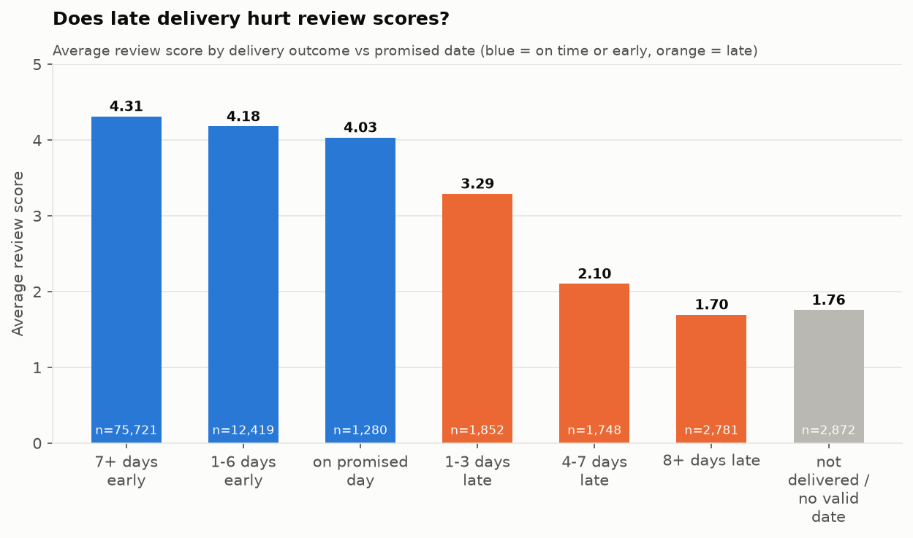 | 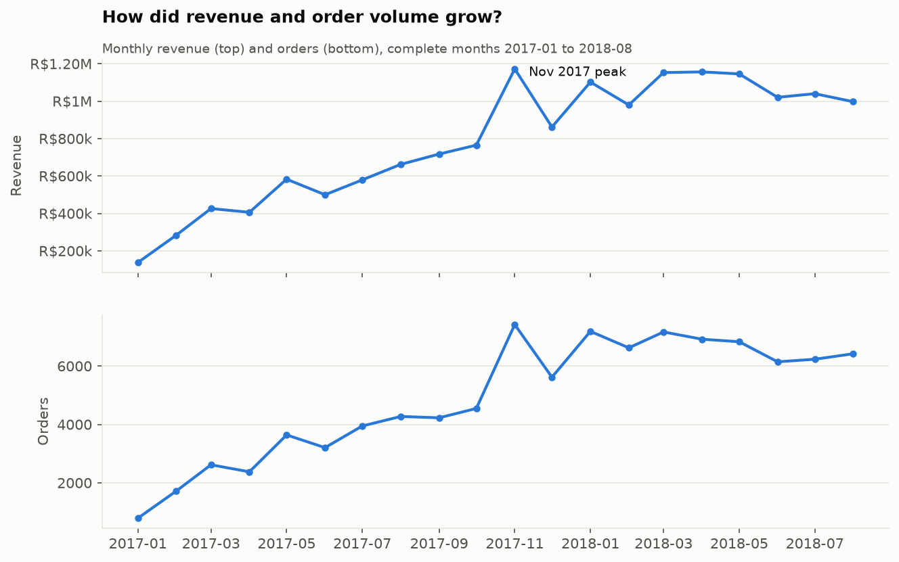 |
| 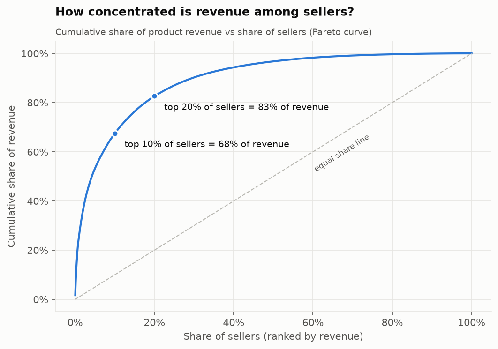 | 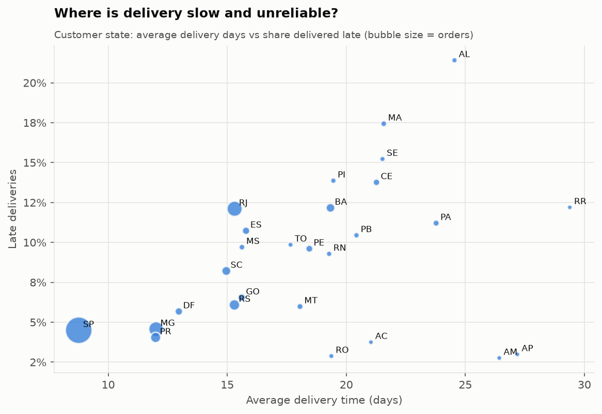 |

All 20 charts: [`reports/charts/`](reports/charts/).

## Customer segmentation (RFM)

Customers are scored on **Recency** and **Monetary** value (quintiles, 1–5) and **Frequency**, then assigned to
seven segments with transparent rules. Because 97% of customers bought only once, frequency quintiles would be
meaningless, so F is used as a one-time vs repeat flag. The reasoning is in [`docs/rfm.md`](docs/rfm.md).
The Python and SQL (`NTILE`) implementations produce **identical** segments.

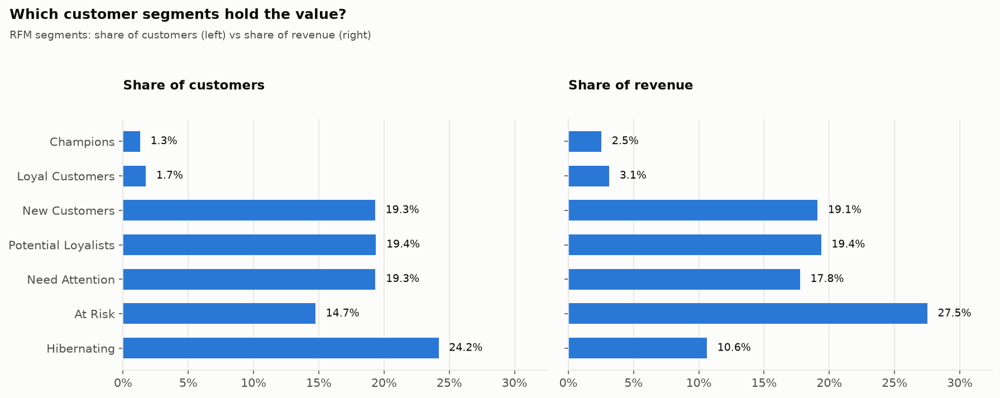

## Power BI dashboard

**Open [`powerbi/marketplace_analytics.pbip`](powerbi/marketplace_analytics.pbip) in Power BI Desktop and
click Refresh.** The report is saved as a Power BI Project (PBIP): the model is TMDL and the report is PBIR,
both plain text, so the whole dashboard is version-controlled without any data.

The five pages are **generated as code** by [`src/reporting/build_dashboard.py`](src/reporting/build_dashboard.py).
That script keeps the hand-built visuals, writes the rest, and is safe to re-run. Every report file is checked
against Microsoft's published PBIR schemas ([`validate_report.py`](src/reporting/validate_report.py)), and
[`tests/test_dashboard.py`](tests/test_dashboard.py) confirms that every field a visual uses exists in the model.

| Page | Contents |
|---|---|
| 1. Executive Overview | Revenue, orders, AOV, customers, YoY growth, monthly trend, MoM growth, revenue by region |
| 2. Product & Category | Top categories, category table (share, units, price, reviews), top products, revenue vs rating |
| 3. Customer Analytics | New vs returning, repeat rate, purchase frequency, RFM segments |
| 4. Regional & Delivery | State map and table, delivery time vs promise, late % trend |
| 5. Payment & Review | Payment methods, order status, review distribution, review score vs delivery |

Slicers on every page: **Date, Product Category, State, Order Status, Payment Type.**

Model: two fact tables at different grains (`fact_orders`, `fact_sales`) plus `fact_payments` and the customer,
product, seller, state and date dimensions. All business logic sits upstream in SQL views, so DAX stays simple.
[`reports/powerbi_expected_values.md`](reports/powerbi_expected_values.md) lists the values each visual must show.

**Executive Overview**
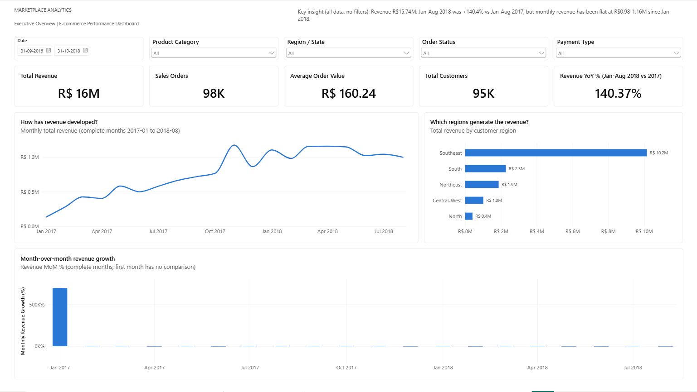

**Product and Category Analysis**
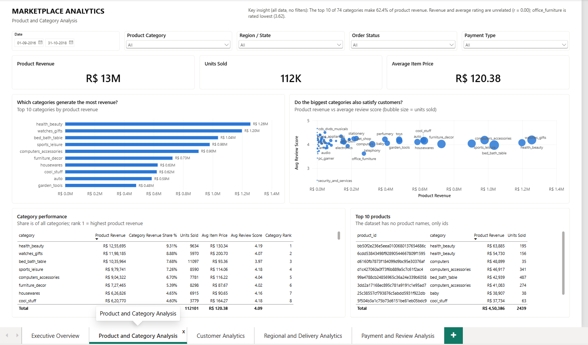

**Customer Analytics**
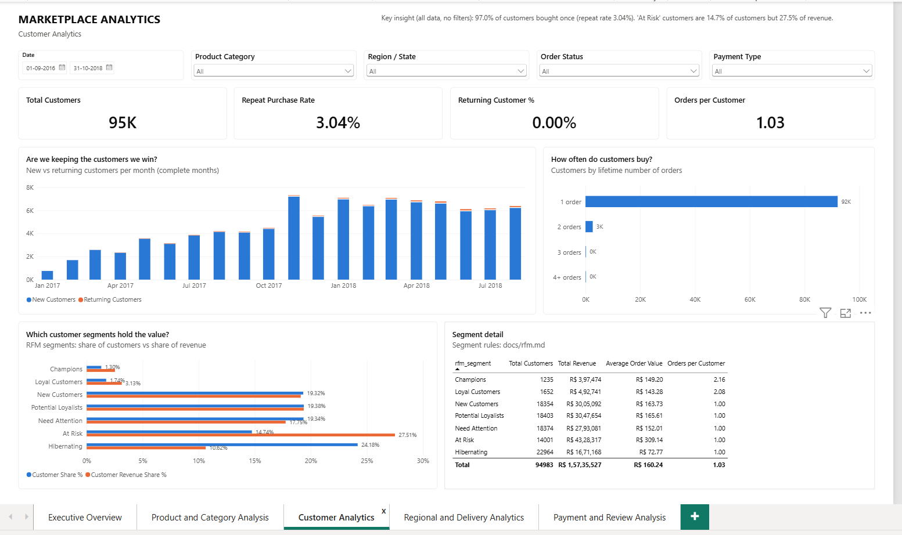

**Regional and Delivery Analytics**
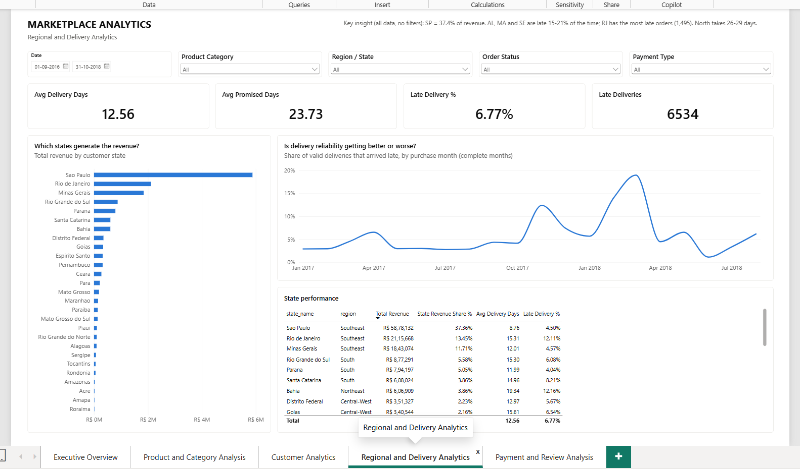

**Payment and Review Analysis**
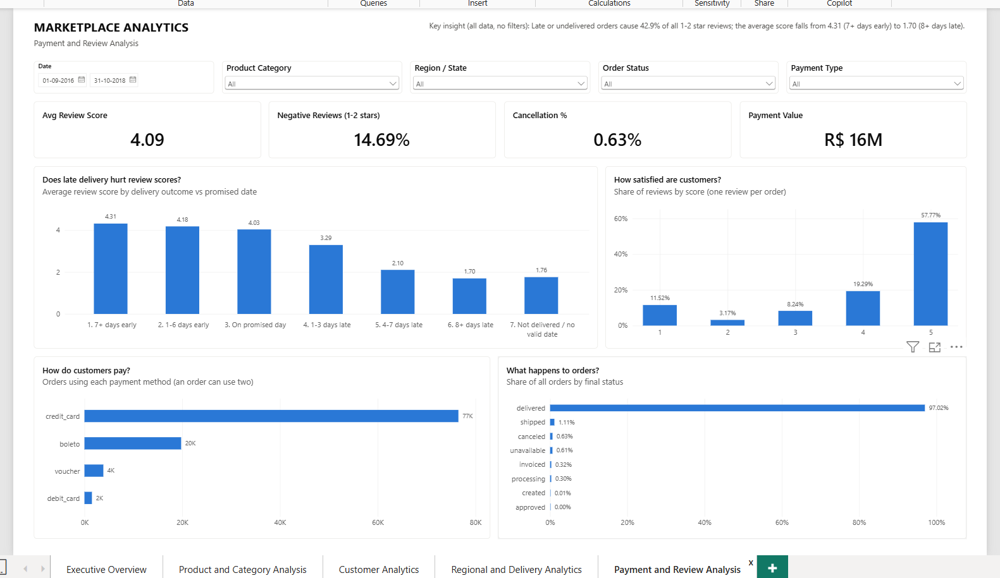

## Business recommendations

Top five of the ten in the [insights report](reports/business_insights.md#8-recommendations):

1. **Make on-time delivery the top operational priority.** Late orders get negative reviews 62.4% of the time vs 9.3% when on time.
2. **Plan logistics capacity before peak events.** The late rate rose to 19.0% in the months after Black Friday.
3. **Launch a second-purchase programme** for 36,757 recent one-time buyers. Repeat buyers spend about twice as much.
4. **Win back "At Risk" customers:** 14,001 high-spend customers holding 27.5% of revenue.
5. **Fix region-specific delivery issues:** unreliable in AL/MA/SE, highest late volume in RJ, slow but padded in the North.

## Installation and how to run

**Prerequisites:** Python 3.12 (pandas has no wheels yet for pre-release Python versions), MySQL 8.0, Git,
and Power BI Desktop (Windows) for the dashboard.

```bash
# 1. Clone and set up the environment
git clone https://github.com/praveenkumar147/marketplace-analytics.git
cd marketplace-analytics
python -m venv .venv
.venv\Scripts\activate          # macOS/Linux: source .venv/bin/activate
pip install -r requirements.txt
```

2. **Download the data** from [Kaggle](https://www.kaggle.com/datasets/olistbr/brazilian-ecommerce) and extract
   the 9 CSV files into `data/raw/`.
3. **Configure MySQL:** copy `.env.example` to `.env` and fill in your own credentials. `.env` is git-ignored.

```bash
# 4. Run the pipeline (each step writes its report to reports/)
python -m src.ingestion.quality_report        # Module A: data quality report        (~10 s)
python -m src.cleaning.pipeline               # Module B: clean + validate           (~1 min)
python -m src.database.load                   # Module C: build and load MySQL       (~2.5 min)
python -m src.analysis.rfm --to-mysql         # RFM segments (+ MySQL table customer_rfm)
python -m src.analysis.sql_runner             # Module D: run all SQL queries        (~1 min)
python -m src.database.powerbi --export-csv   # Module F: reporting views + CSV export
jupyter nbconvert --to notebook --execute --inplace notebooks/01_exploratory_data_analysis.ipynb

# 5. Run the tests
pytest -q
```

6. **Power BI:** open `powerbi/marketplace_analytics.pbip`, enter your MySQL credentials when asked, and click
   **Refresh**. To regenerate the report pages: `python -m src.reporting.build_dashboard` (with Power BI closed).
   Model details: [`powerbi/dashboard_guide.md`](powerbi/dashboard_guide.md).

## Project structure

```
marketplace-analytics/
├── data/
│   ├── raw/                  # Olist CSVs (downloaded, git-ignored, never modified)
│   ├── processed/            # cleaned tables + customer_rfm.csv (generated)
│   └── powerbi/              # view exports for the Power BI CSV route (generated)
├── docs/                     # data model, database design, SQL guide, RFM method
├── notebooks/                # EDA notebook (with outputs)
├── powerbi/
│   ├── dashboard_guide.md    # step-by-step build guide
│   ├── measures/measures.dax # 41 DAX measures + date table
│   └── theme/                # Power BI theme JSON
├── reports/
│   ├── charts/               # 22 PNG charts
│   ├── sql_results/          # CSV result of every SQL query
│   ├── business_insights.md  # findings + recommendations
│   └── *.md                  # auto-generated quality, cleaning, load, SQL, RFM, Power BI reports
├── sql/
│   ├── schema/               # CREATE DATABASE / TABLES
│   ├── analysis/             # 25 business queries
│   └── views/                # Power BI reporting views
├── src/
│   ├── config.py             # paths + environment variables
│   ├── ingestion/            # Module A: loader, profiler, quality report
│   ├── cleaning/             # Module B: cleaners, validation, pipeline
│   ├── database/             # Module C/F: connection, schema, loader, Power BI views
│   └── analysis/             # Module D/E + RFM: SQL runner, EDA helpers, RFM
├── tests/                    # 115 pytest tests
├── .env.example              # template for MySQL credentials
├── requirements.txt
└── README.md
```

## Testing and data quality

- **115 automated tests** (`pytest -q`): unit tests on small hand-made DataFrames for every cleaning rule and
  metric, plus integration tests on the real data and the live database.
- **Cross-tool verification:**
  - pandas = SQL for revenue, AOV, repeat rate and late %
  - Python RFM = SQL RFM, segment by segment
  - reporting views = base tables
  - DAX references are checked against the view columns
- **Validation gates:** the cleaning pipeline refuses to save data that breaks a rule; the database loader
  verifies row counts and orphans and that the constraints reject bad writes.
- **A real bug caught this way:** the first version of the category-share query divided by a total that a
  `HAVING` filter had already reduced, because window functions run after `HAVING`. The notebook's pandas figure
  exposed the mismatch, and the query was fixed.

## Limitations and future improvements

**Limitations:**
- no cost or margin data
- no product names or marketing data
- data ends in 2018
- the link between late delivery and bad reviews is a strong association, not a proven cause

**Future improvements:**
- Publish the dashboard to Power BI Service with scheduled refresh.
- Orchestrate the pipeline (e.g. a single `make`-style command or Airflow) and add CI that runs the tests on each push.
- Delivery-delay prediction to flag at-risk orders before they are late.
- Customer lifetime value and cohort retention curves.
- Text analysis of review comments (Portuguese) to find the reasons behind low scores.
- A/B test design for the second-purchase campaign.

---

**Author:** [praveenkumar147](https://github.com/praveenkumar147)

**Data:** © Olist, licensed under CC BY-NC-SA 4.0. This project is non-commercial and for educational and portfolio use.
