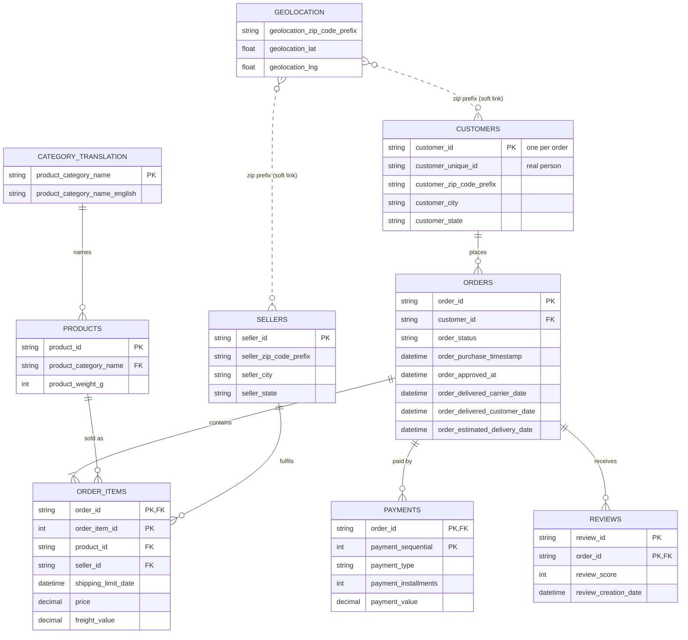

# Data Model and Module A Findings

This document explains how the nine Olist tables relate to each other and what
Module A (data understanding) found. All numbers come from
[`reports/data_quality_report.md`](../reports/data_quality_report.md), which is
generated by `python -m src.ingestion.quality_report`.

## 1. Entity relationship diagram

## 2. Table grain (what one row means)

| Table | One row = | Primary key | Verified unique? |
|---|---|---|---|
| customers | a customer **per order** | `customer_id` | Yes |
| orders | an order | `order_id` | Yes |
| order_items | one item line in an order | (`order_id`, `order_item_id`) | Yes |
| payments | one payment line (orders can be split, e.g. card + voucher) | (`order_id`, `payment_sequential`) | Yes |
| reviews | a review attached to an order | (`review_id`, `order_id`) | Yes (composite only) |
| products | a product | `product_id` | Yes |
| sellers | a seller | `seller_id` | Yes |
| geolocation | one GPS sample for a zip prefix | none | 261,831 exact duplicate rows |
| category_translation | a category name | `product_category_name` | Yes |

### The most important modelling trap: `customer_id` vs `customer_unique_id`

Olist creates a **new `customer_id` for every order**, so `customers` has exactly
as many rows as `orders` (99,441). The real person is `customer_unique_id`
(96,096 people). **Every retention, repeat-purchase and RFM metric must use
`customer_unique_id`.** Counting by `customer_id` would show 0% repeat customers.

Only **2,997 customers (3.12%) placed 2 or more orders**. This is a property of
the dataset, not a bug, and it limits how much retention and frequency analysis
can show (see RFM notes in a later module).

## 3. Relationships and referential integrity

| Relationship | Cardinality | Result |
|---|---|---|
| orders -> customers | many-to-one (in practice 1:1) | 0 orphans |
| order_items -> orders | many-to-one | 0 orphans |
| order_items -> products | many-to-one | 0 orphans |
| order_items -> sellers | many-to-one | 0 orphans |
| payments -> orders | many-to-one | 0 orphans |
| reviews -> orders | many-to-one | 0 orphans |
| products -> category_translation | many-to-one | **13 products in 2 untranslated categories** (`pc_gamer`, `portateis_cozinha_e_preparadores_de_alimentos`); 610 products have no category |
| customers/sellers -> geolocation | soft link on zip prefix | 278 customers (0.28%) have a zip prefix missing from geolocation |

Geolocation has many rows per zip prefix, so it cannot be a foreign-key parent
as it is. Module B will aggregate it to one row per prefix (median lat/lng).

## 4. Data quality findings and the cleaning decision for each

| # | Finding (raw data) | Count | Decision for Module B |
|---|---|---|---|
| 1 | Data covers 2016-09-04 to 2018-10-17, but 2016-09 (4 orders), 2016-12 (1), 2018-09 (16) and 2018-10 (4) are near-empty; 2016-11 has none | - | Keep all rows; flag **2017-01 to 2018-08** as the complete analysis window for trend and growth charts so partial months don't fake a collapse. |
| 2 | Orders with no item rows | 775 (603 unavailable, 164 canceled, 5 created, 2 invoiced, 1 shipped) | Keep in `orders` for status/cancellation metrics; they naturally drop out of item revenue. |
| 3 | `delivered` status but no customer delivery date | 8 | Exclude from delivery-time metrics only. |
| 4 | Non-delivered status but has a delivery date | 6 | Keep; trust status for status metrics, exclude from delivery-time metrics. |
| 5 | Delivered to customer before handed to carrier | 23 | Flag as invalid logistics sequence; exclude from delivery-time metrics. |
| 6 | Handed to carrier before purchase | 166 | Flag; carrier timestamp not used in core KPIs. |
| 7 | Missing timestamps: approved 160, carrier 1,783, delivered 2,965 | - | Leave as NULL (they mean "did not happen yet"); never impute dates. |
| 8 | Item total vs payment total differs by more than R$1 | 249 orders (0.25%) | Use **item price + freight** as the revenue definition; document the gap. |
| 9 | Payments with value <= 0 | 9 (6 voucher, 3 not_defined) | Drop the 3 `not_defined` rows; keep zero-value vouchers (they are real voucher lines). |
| 10 | `payment_installments` = 0 | 2 | Set to 1 (every payment has at least one installment). |
| 11 | One `review_id` attached to several orders | 1,603 rows | Valid in source data (one survey covering several orders); keep. |
| 12 | Orders with more than one review | 1,098 rows | Keep all reviews in the reviews table; for "one score per order" use the **latest** review. |
| 13 | Review comment title / message empty | 88.3% / 58.7% | Expected (comments are optional); keep NULL. |
| 14 | Products with no category | 610 (1.85%) | Label `unknown`. |
| 15 | Categories missing from translation file | 2 categories, 13 products | Add manual English names (`pc_gamer`, `portable_kitchen_food_preparers`). |
| 16 | Product weight 0 g / missing dimensions | 4 / 2 | Set weight 0 to NULL (physically impossible); keep NULL dimensions. |
| 17 | Seller city spellings: accents, double spaces, apostrophes | 5 duplicates | Normalize: lower-case, strip accents, collapse spaces. |
| 18 | Seller cities with state suffixes or junk (`auriflama/sp`, `sp / sp`, `04482255`, an email address) | ~20 values | Strip `/state` and `, state, brasil` suffixes; set junk values (digits, emails, state codes) to NULL. |
| 19 | Geolocation exact duplicate rows | 261,831 | Drop duplicates, then aggregate to one row per zip prefix. |
| 20 | Geolocation city spelling variants | 2,045 of 8,011 distinct values | Normalize text the same way as cities. |
| 21 | Geolocation points outside Brazil | 31 | Drop before aggregating. |
| 22 | Orders with no review | 768 | Expected; review metrics are computed over reviewed orders only. |

### Outliers (numeric summary)

- `price`: median R$74.99, 99th percentile R$890, max R$6,735.
- `freight_value`: median R$16.26, 99th percentile R$84.52, max R$409.68; 383 items have free shipping (0).

High prices are plausible for a marketplace that sells electronics and furniture,
so they are **kept, not removed**. Removing them would understate revenue.
Charts that are sensitive to skew will use medians or log scales instead.

## 5. Revenue definition (decided here, used everywhere)

> **Revenue = sum of `price` + `freight_value` from `order_items`, for orders
> whose status is not `canceled` or `unavailable`.**

Reasons: item-level revenue can be split by product, category and seller, which
payment-level revenue cannot. Payment totals agree within R$1 for 99.75% of
orders. Product-only revenue (`price` without freight) is also reported where
useful (e.g. category ranking).
