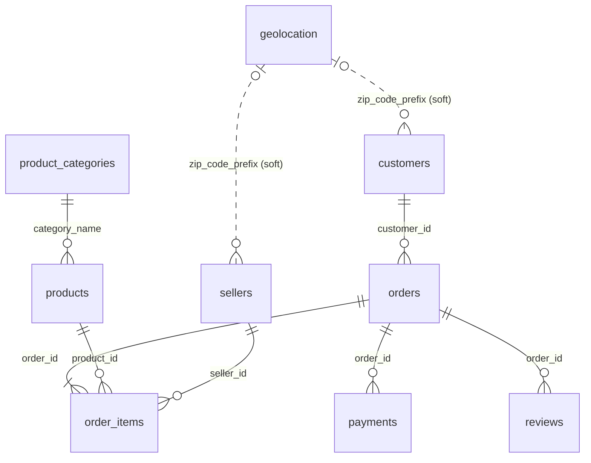

# MySQL Database Design

Database: `marketplace_analytics` (MySQL 8.0, InnoDB, utf8mb4).
Rebuild from scratch at any time:

```bash
python -m src.cleaning.pipeline   # data/raw -> data/processed
python -m src.database.load       # data/processed -> MySQL (+ verification)
```

The scripts can also be run by hand in MySQL Workbench:
`sql/schema/01_create_database.sql`, then `sql/schema/02_create_tables.sql`.

Verification output: [`reports/database_load_report.md`](../reports/database_load_report.md).

## 1. Schema



| Table | Rows | Primary key | Role |
|---|---|---|---|
| `orders` | 99,441 | `order_id` | Fact: one row per order, with delivery flags/metrics |
| `order_items` | 112,650 | (`order_id`, `order_item_id`) | Fact: revenue grain (price + freight) |
| `payments` | 103,883 | (`order_id`, `payment_sequential`) | Fact: payment lines |
| `reviews` | 99,224 | (`review_id`, `order_id`) | Fact: review scores |
| `customers` | 99,441 | `customer_id` | Dimension (person = `customer_unique_id`) |
| `products` | 32,951 | `product_id` | Dimension |
| `product_categories` | 74 | `category_name` | Lookup: Portuguese -> English |
| `sellers` | 3,095 | `seller_id` | Dimension |
| `geolocation` | 19,011 | `zip_code_prefix` | Lookup: one GPS point per zip prefix |

## 2. Data type choices

| Choice | Why |
|---|---|
| `CHAR(32)` for ids | Every Olist id is exactly 32 hex characters; fixed width is compact and fast to compare. |
| `DECIMAL(10,2)` for money | Exact decimal arithmetic. `FLOAT` cannot represent 0.10 exactly and totals drift. |
| `CHAR(5)` for zip prefixes | Text keeps leading zeros (`01037`); zips are labels, not numbers. |
| `DATETIME` for timestamps, `DATE` for `purchase_date` | Native date functions (`DATE_FORMAT`, `DATEDIFF`) and date-range indexes. |
| `BOOLEAN` flags (`is_revenue_order`, `is_late`, ...) | Business rules decided once in Python; SQL just filters on them. `is_late` is NULL when the order was not a valid delivery, so `AVG(is_late)` automatically ignores those orders. |
| `utf8mb4` | Full Unicode: Portuguese accents and emoji in review text. |

## 3. Integrity rules

**Foreign keys (7):** orders -> customers; order_items -> orders, products, sellers;
payments -> orders; reviews -> orders; products -> product_categories.

**CHECK constraints (8):** valid order status list, `delivery_days >= 0`,
`price > 0`, `freight_value >= 0`, valid payment types, `installments >= 1`,
`payment_value >= 0`, `review_score BETWEEN 1 AND 5`.

These are proven to work: after loading, `load.py` attempts four bad writes
(unknown order id, score of 9, negative price, duplicate key) inside a
transaction that is rolled back, and MySQL rejects every one.

**Soft link, not a FK:** customers/sellers -> geolocation on `zip_code_prefix`.
279 customers (0.28%) have a zip prefix with no GPS point in the source data, so a
strict FK would force us to delete real customers and their orders. The column is
indexed so the join is still fast; map visuals simply skip those 279 customers.

## 4. Normalization

The schema is in third normal form (3NF) for the stored facts:
- The English category name is stored only in `product_categories`, not
  repeated on 32,951 product rows. Renaming a category is a one-row update.
- Customer location is stored on `customers`, not repeated on orders.

Derived columns on `orders` (e.g. `delivery_days`, `is_late`) are a deliberate,
documented denormalization: they are computed once by the tested Python
pipeline so every SQL query and the Power BI model use the same definition.

## 5. Indexes and why

| Index | Supports |
|---|---|
| `orders(order_purchase_timestamp)`, `orders(purchase_year_month)` | Monthly trends, date filters |
| `orders(order_status)` | Cancellation rate, status breakdown |
| `orders(customer_id)`, `customers(customer_unique_id)` | Repeat-customer and RFM queries |
| `order_items(product_id)`, `order_items(seller_id)` | Top products, revenue by seller |
| `customers(state)`, `sellers(state)` | Regional revenue |
| `payments(payment_type)`, `reviews(score)`, `reviews(order_id)` | Payment mix, review analysis |
| `customers(zip_code_prefix)`, `sellers(zip_code_prefix)` | Geolocation join |

Primary-key columns are indexed automatically by InnoDB, and so are the
leading columns of composite keys (`order_items.order_id`, `payments.order_id`).

## 6. Revenue cross-check

Total revenue computed in MySQL
(`SUM(line_total)` over orders with `is_revenue_order = 1`) equals the pandas
figure from the clean CSVs to the cent: **R$15,735,527.03 across 98,199 orders**.
