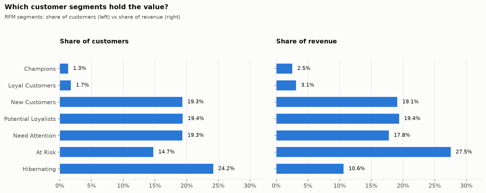
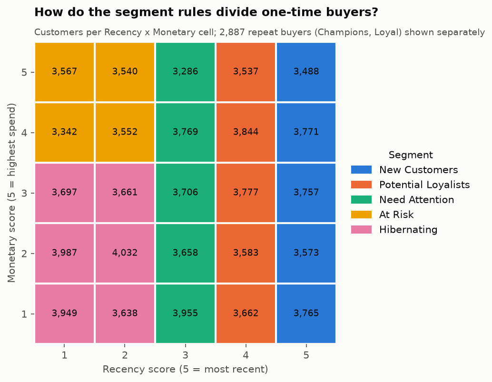

# RFM Customer Segmentation - Results

_Auto-generated by `src/analysis/rfm.py` on 2026-11-12 13:42. Method and reasoning: `docs/rfm.md`._

- Snapshot date: **2018-09-04** (day after the last purchase)
- Customers scored: **94,983** (`customer_unique_id` with at least one revenue order with items)
- Revenue covered: **R$15,735,527.03**

## Why frequency is rule-based

| orders | customers | pct |
|---|---|---|
| 1 | 92096 | 96.96 |
| 2 | 2651 | 2.79 |
| 3 | 188 | 0.2 |
| 4+ | 48 | 0.05 |

With most customers on exactly 1 order, frequency quintiles would put the same value in four of the five groups, so F is used as one-time (F=1), 2 orders (F=4) or 3+ orders (F=5).

## What each score means

| score | recency_days_range | monetary_range | customers_r | customers_m |
|---|---|---|---|---|
| 1 | 389-730 | R$9.59 - R$55.36 | 18997 | 18997 |
| 2 | 274-389 | R$55.36 - R$87.50 | 18997 | 18997 |
| 3 | 183-274 | R$87.51 - R$133.05 | 18997 | 18997 |
| 4 | 99-183 | R$133.05 - R$209.11 | 18996 | 18996 |
| 5 | 1-99 | R$209.11 - R$13,664.08 | 18996 | 18996 |

## Segment rules

| segment | frequency | R score | M score | meaning / action |
|---|---|---|---|---|
| Champions | 2+ orders | 4-5 | any | Bought more than once and recently. Reward; ask for reviews/referrals. |
| Loyal Customers | 2+ orders | 1-3 | any | Proven repeat buyers, not recent. Win-back offer before they lapse. |
| New Customers | 1 order | 5 | any | First purchase in the most recent fifth. Onboarding; drive a 2nd order. |
| Potential Loyalists | 1 order | 4 | any | Recent one-time buyers. Best target to convert into repeat customers. |
| Need Attention | 1 order | 3 | any | Middle-aged one-time buyers. Reminder campaigns, recommendations. |
| At Risk | 1 order | 1-2 | 4-5 | Big spenders who never came back. Personal win-back offer. |
| Hibernating | 1 order | 1-2 | 1-3 | Low-value, long-inactive one-time buyers. Low-cost mass campaigns only. |

## Segment summary

| segment | customers | customer_pct | revenue | revenue_pct | avg_recency_days | avg_orders | avg_monetary | median_monetary |
|---|---|---|---|---|---|---|---|---|
| Champions | 1235 | 1.3 | 397473.9 | 2.53 | 94.45 | 2.16 | 321.84 | 236.31 |
| Loyal Customers | 1652 | 1.74 | 492741.31 | 3.13 | 326.87 | 2.08 | 298.27 | 217.45 |
| New Customers | 18354 | 19.32 | 3005091.62 | 19.1 | 51.22 | 1.0 | 163.73 | 107.85 |
| Potential Loyalists | 18403 | 19.38 | 3047654.44 | 19.37 | 141.61 | 1.0 | 165.61 | 108.46 |
| Need Attention | 18374 | 19.34 | 2793081.21 | 17.75 | 226.24 | 1.0 | 152.01 | 104.68 |
| At Risk | 14001 | 14.74 | 4328316.95 | 27.51 | 400.82 | 1.0 | 309.14 | 211.77 |
| Hibernating | 22964 | 24.18 | 1671167.6 | 10.62 | 402.2 | 1.0 | 72.77 | 70.27 |

## Charts

